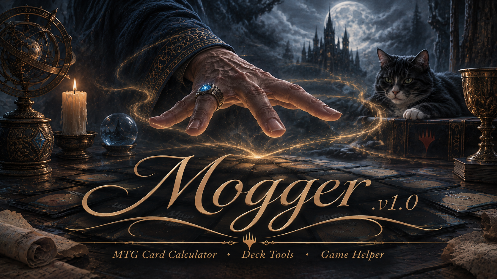

# Mogger

Mogger is a local MTG Arena match tracker and deck-construction tool.

It has three parts, all running locally:

- **`watcher.py`** — a background service that tails Arena's `Player.log`, parses the live
  GRE game-state messages, and records every finished match to `history.json`: result, opponent,
  a full turn-by-turn play-by-play (every card that hit a public zone, with turn number, hand
  contents, life totals, and mana available at the time), and a derived "threat index" of cards
  that show up most often in matches you lost.
- **`dashboard.html`** — a single-file web dashboard (served locally by `server.py`) showing the
  match list, an interactive play-by-play timeline per match, and the threat index.
- **Construct Deck ("Mogger")** — a deckbuilding feature in the dashboard with three paths:
  - **AI-direct**: calls the Anthropic API with a prompt grounded in your real match history
    (threat index, win/loss record, legal card pool for the chosen format) to generate a deck,
    then validates the result (exact size, 4-copy cap, format legality, color identity) before
    showing it, with one corrective retry on failure.
  - **Generate Prompt**: assembles the same grounded prompt without calling the API, so you can
    paste it into Claude (or any model) yourself, for free.
  - **Tier-list fallback**: scrapes a current community tier list and picks the best-fit deck
    against your threat index, scaling it to any target size with real deckbuilding rules
    (land-only scaling, no card over 4 copies, color-identity-respecting).

Every generated or scaled decklist is output in MTGA's import format, ready to paste into Arena.

## Running it

Two systemd user services:
- `mtga-watcher.service` — runs `watcher.py` against your Arena `Player.log`.
- `mtga-dashboard.service` — runs `server.py`, serving the dashboard at `http://localhost:8777`.

`cards.json` (a filtered Scryfall card dump) and `history.json` (your own match data) are
gitignored - regenerate `cards.json` by letting `watcher.py` refresh it, and `history.json`
builds up from your own matches.

The AI-direct deck path needs an `ANTHROPIC_API_KEY`, read from the environment or from a local
`.env` file (also gitignored - never commit this).
